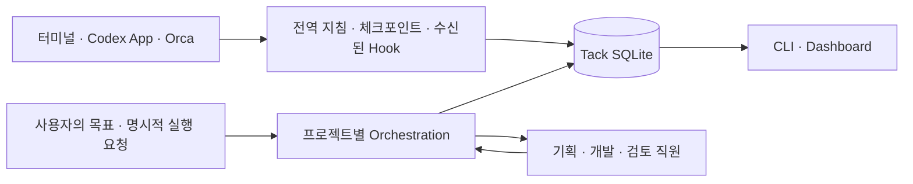

<div align="center">

# Tack

### 에이전트와 하는 개발을, 이어지는 작업으로.

**작업과 세션을 기록하고, 필요한 프로젝트에서는 역할을 가진 에이전트 팀과 함께 개발합니다.**

Local-first · CLI & Dashboard · SQLite · Optional orchestration

[왜 Tack인가](#왜-tack인가) · [빠른 시작](#빠른-시작) · [웹 사무실](#웹-사무실) · [팀과 데모데이](#프로젝트-안의-여러-팀과-데모데이) · [에이전트 팀 실행](#에이전트-팀과-개발하기) · [실행 모드](#실행-모드와-권한) · [개입 방식](#개발-흐름에-어떻게-개입하나) · [상세 안내](#명령과-운영-레퍼런스)

</div>

---

Tack은 **개발 작업의 상태와 근거를 세션 밖에 남기는 로컬 도구**입니다. 무엇을 하던 중이었는지, 어떤 결정을 기다리는지, 실제 검증이 끝났는지를 CLI와 대시보드에서 같은 기록으로 확인합니다.

프로젝트에 **Tack Orchestration**을 추가하면 기획·개발·검토 같은 역할을 가진 에이전트에게 업무를 맡길 수 있습니다. 직원들은 각자의 업무를 수행하고, 동료에게 질문하고, 검토와 수정을 이어갑니다. 사용자는 방향을 지시하고 중요한 결정과 최종 완료를 승인합니다.

> **전역에는 작업·세션 관리자. 프로젝트에는 선택형 에이전트 팀.**
>
> 두 도구가 같은 Tack DB를 사용하므로 기록과 실행을 연결할 수 있습니다.

## 왜 Tack인가

에이전트가 코드를 작성하는 것과 개발 작업을 끝까지 관리하는 것은 별개의 문제입니다.

| 개발하면서 생기는 문제 | Tack으로 얻는 것 |
| --- | --- |
| 세션을 바꾸면 맥락과 다음 행동을 다시 설명해야 합니다. | 작업·결정·의존성·체크포인트를 저장하고 다음 세션에서 재개합니다. |
| TODO·진행·인계 문서가 늘어나 최신 상태를 찾기 어렵습니다. | 가변적인 작업 상태는 SQLite에, 오래 참조할 설계·API 문서는 저장소에 둡니다. |
| 에이전트가 끝났다고 말해도 검증 여부를 알기 어렵습니다. | 실행 종료·작업 완료·검증 결과를 구분하고, 팀 목표의 최종 완료는 사용자가 승인합니다. |
| 여러 에이전트의 담당 업무와 대기 이유가 보이지 않습니다. | 담당자·선행 업무·실행 큐·질문·검토·산출물을 연결해서 봅니다. |
| 협업할수록 모델 호출과 토큰 사용량이 불투명해집니다. | 수집된 실행별 입력·캐시 입력·출력·소요 시간을 조회합니다. |

## 두 가지 방식으로 사용합니다

| | **Tack** | **Tack Orchestration** |
| --- | --- | --- |
| 역할 | 작업·세션 관리 | 역할 에이전트의 개발 업무 실행·조정 |
| 설치 | 사용자 전역에 한 번 | 필요한 프로젝트에만 추가 |
| 기록 | 작업, 결정, 의존성, 검증, 체크포인트, 보관 문서 | 같은 DB에 목표, 업무 배정, 메시지, 실행, 사용량 추가 |
| 에이전트 실행 | 기록만 관리합니다. | 설치된 Codex CLI로 별도 역할 에이전트를 실행합니다. |
| 화면 | 작업 보드·QA·세션·프로젝트·사용량 | 웹 사무실·대화·업무 보드·결재함·팀 구성·데모데이 |
| CLI | `tack` | `./.tack-orchestration/bin/tack-orchestration` |

**Tack만 사용해도 됩니다.** 대시보드를 띄우지 않아도 기록·조회·재개가 가능하며, 오케스트레이션도 CLI로 실행할 수 있습니다.

## 웹 사무실

프로젝트의 선택형 오케스트레이션을 설치하면 `/team`에서 팀을 운영할 수 있습니다.

- **사무실** — 실제 Codex 세션을 직원으로 표시합니다. 팀 없이 시작하거나, 사전 구성한 팀의 역할로 새 세션을 열 수 있습니다. 목록·직원을 선택하면 대화 ID·프로필·폴더·팀 연결·재개 방법을 확인합니다. Tack에서 시작한 세션은 직접 지시·중단·실행 승인을 지원합니다. 드래그·확대·애니메이션 전환과 모바일 목록을 제공하며, 연결된 대기 세션은 커피 코너·휴게 공간으로 이동하는 연출을 사용합니다. 외부 세션의 실시간 상태는 추측하지 않습니다. Canvas는 최대 24fps이며 비활성 탭·움직임 줄이기 설정에서는 반복 애니메이션을 멈춥니다.
- **대화** — 팀 단체방과 직원 개인방. 메모·질문·새 업무를 구분합니다.
- **업무 보드** — 대기·진행·확인 필요·완료를 같은 업무 기록으로 보여줍니다. 대기 업무 카드를 열어 **업무 삭제**로 실행 대상에서 제외하고, 업무함의 **삭제된 업무**에서 복원할 수 있습니다. 실행 중·완료 업무와 다른 업무가 의존하는 항목은 삭제를 막습니다. 복원은 자동 실행하지 않으며 개발 업무는 범위를 다시 승인합니다.
- **결재함** — 사용자 답변, 업무 범위 승인, 병합 확인과 최종 결과 승인을 모읍니다. 새 사용자 질문은 보통 2~3개 선택지와 권장안·이유를 제시합니다. 미리 선택하거나 자동 제출하지 않으며, 직접 답변과 추가 조건 입력도 가능합니다. 선택한 내용은 질문·답변과 함께 SQLite에 저장하고 다음 실행에 전달합니다. 기존 텍스트 질문은 그대로 답변할 수 있습니다.
- **보고서** — 완료된 업무의 미리보기에서 산출물·검증 원문을 엽니다.
- **팀 구성** — 앱별 제품 팀과 직군별 지원 팀을 만들고 직원·담당 경로·실행 한도를 설정합니다.
- **데모데이** — 검증된 결과를 발표장에서 확인하고 수락·수정 요청·보류를 결정합니다.

사무실의 **세션 시작**은 계획 단계를 강제하지 않습니다. 팀 단위 목표 분해·위임·검토가 필요하면 상단 **목표 맡기기**와 기존 대화·업무 보드를 사용합니다. **팀 구성**의 역할 프리셋은 새 세션을 시작할 때 선택하며, 이미 연결한 세션의 지침은 분류 변경으로 바뀌지 않습니다.

**팀 설정 → 실행 연결**에서 기존 `Codex CLI` 또는 선택형 `Codex app-server`를 고를 수 있습니다. 기본값은 기존 CLI입니다. app-server는 직원별 연결을 실행 중 재사용하고, 같은 목표·대화 채널·읽기/쓰기 범위·역할 설정의 대화를 재개합니다. 권한이 다른 대화는 분리하며 중단 시 소유한 실행을 종료합니다. 프로세스 재시작은 대화 ID와 체크포인트로 복구하므로 실행 중인 메모리 전체를 재현하지는 않습니다. 설치된 Codex의 로그인과 app-server 지원이 필요합니다.

사무실·업무함은 **웹 기반**이며 로컬 서버에서 동작합니다. 전역 Tack Core에는 직원 실행기와 사무실 자산을 설치하지 않습니다. 실행 허용 없이 연 서버는 조회 전용입니다.

## 프로젝트 안의 여러 팀과 데모데이

**팀 구성**에서 앱별 제품 팀 또는 기획·개발·QA 같은 직군별 지원 팀을 만듭니다. 직원은 고유 ID와 직군을 가지며, 팀 구성과 별개로 기록·세션을 유지합니다. 팀을 만들 때 기획·개발·QA 역할 프리셋 3개를 준비하거나 기존 역할을 선택할 수 있습니다. 필요한 지원 팀을 연결하면 같은 목표에 함께 참여합니다.

- 모노레포에서는 `apps/chess`, `apps/shop`, `packages/ui`처럼 담당 경로를 지정합니다. 서로 다른 팀이 같은 경로를 소유할 수 없고, 공유 패키지는 소유 팀 하나에 맡깁니다. 지원만 하는 팀은 담당 경로를 비워둘 수 있습니다.
- 새 목표는 담당 팀의 구성원·경로·예산을 저장합니다. 나중에 팀 범위를 넓혀도 기존 목표의 권한은 자동으로 늘지 않습니다. 범위를 줄이면 기존 실행의 배정·통합에도 적용됩니다.
- 서로 다른 경로의 팀은 병렬 실행할 수 있습니다. 같은 팀의 목표는 순서대로 처리하며, 공유 직원의 중복 실행과 프로젝트 전체 실행 한도를 함께 검사합니다. 목표 담당 팀별로 누적 토큰 한도를 적용하며 한 응답에서 한도를 넘을 수 있습니다. 지원 직원의 실행도 목표 담당 팀 예산에 집계합니다.
- 기존 직원·목표는 **기존 팀**에서 계속 조회합니다. 기존 목표의 대화·검증·승인과 프로젝트 단위 실행 방식은 보존합니다. 지원 팀 연결은 해당 목표의 승인된 경로를 확대하지 않습니다.

**데모데이**는 업무와 실제 검증을 마친 목표를 모아 팀별로 발표합니다. 발표장을 넘기며 산출물 원문, 변경 파일, 결과물 링크, 검증 명령과 사용량을 확인하고 **결과 수락 / 수정 요청 / 보류**를 선택합니다. 발표는 기존 기록을 사용하므로 모델을 추가 호출하지 않습니다. 발표 후 결과가 바뀌면 수락을 차단하며, 수정 요청은 원래 범위를 유지한 후속 목표와 실행 큐로 연결합니다. 발표 자료와 피드백은 SQLite에 보존합니다.

### 팀을 만들고 결과를 받는 순서

1. **팀 구성 → 팀 만들기**에서 제품·지원 팀, 구성원과 담당 경로를 정합니다. 제품 팀을 새로 구성하면 기획·개발·QA 역할 프리셋이 준비됩니다.
2. 상단 **작업 팀 선택**에서 팀을 고르고 **목표 맡기기**로 업무를 등록합니다. 실행 모드에 따라 기획·구현·검토·검증이 진행됩니다.
3. 업무와 검증이 끝나면 **데모데이 → 검증된 결과로 데모데이 열기**에서 전체 팀 또는 특정 팀의 결과를 모읍니다.
4. 발표별 검증 근거를 확인하고 결과를 수락하거나 피드백을 전달합니다. 수정 요청은 같은 팀의 후속 목표로 등록되며 원래 승인 범위와 검증 명령을 유지합니다. 보류한 발표는 나중에 다시 결정할 수 있습니다.

한 프로젝트에 최대 20개 팀을 구성할 수 있습니다. 목표에 참여하는 직원은 지원 팀을 포함해 최대 12명이며, 실제 동시 실행 수는 프로젝트·담당 팀·위임 한도의 영향을 받습니다. 팀 토큰 예산은 담당 목표들의 누적 사용량입니다.

CLI에서 담당 팀을 지정하려면 `tack-orchestration team create "목표" --team-id TEAM_ID`를 사용합니다. 팀 관리와 데모데이는 프로젝트 하네스 전용이며 전역 Tack Core는 계속 기록만 관리합니다.

## 실제 Codex 세션을 직원으로 보기

웹 사무실의 직원은 **현재 작업 중인 실제 Codex 세션 하나**입니다. 팀을 만들지 않아도 기존 세션을 불러와 볼 수 있고, 필요할 때 팀으로 분류할 수 있습니다. 기존 목표·팀·업무·데모데이 기록도 계속 조회하고 사용할 수 있습니다.

- **기본 사무실 · 지금 작업:** 현재 프로젝트에서 실행 중이거나 사용자 답변·실행 승인을 기다리는 것으로 확인된 세션만 표시합니다. 응답이 끝난 세션은 사무실에서 빠지고 기록에 남습니다. 기본 조회는 과거 세션 목록을 읽지 않습니다.
- **세션 기록:** 완료·중단·외부 세션은 별도 목록에서 검색하고 재개합니다. 기본 범위는 현재 프로젝트이며, 필요한 경우에만 **이 PC의 세션**으로 넓힐 수 있습니다. 기본 Codex 프로필, 현재 `CODEX_HOME`, 존재하는 `.codex-company` 프로필의 기록을 공식 app-server `thread/list`로 조회합니다. 과거 기록은 사무실의 직원으로 펼치지 않습니다.
- **팀 없이 시작:** 사무실의 **세션 시작 → 팀 없이 시작**에서 첫 지시를 입력하면 현재 프로젝트에서 Codex 세션을 직접 시작합니다. 기획 목표를 먼저 생성하거나 팀 편성을 승인할 필요가 없습니다.
- **팀을 먼저 구성:** **팀 구성**에서 팀과 역할을 준비한 후 **세션 시작**에서 해당 팀·역할을 고릅니다. 역할 지침·모델·설정된 Skill이 새 세션에 적용됩니다. 기획·검토 역할은 읽기 전용이고, 개발 역할은 팀 담당 폴더에서 시작합니다.
- **나중에 팀 연결:** 직원 상세의 **팀 연결**에서 팀을 지정하거나 해제합니다. 분류 변경은 이미 진행 중인 세션의 지침·권한을 변경하지 않습니다.
- **직접 실행한 세션:** Tack에서 연 세션에는 다음 지시를 보내고 실행을 중단할 수 있습니다. Codex가 실행 승인을 요청하면 명령을 확인하고 이번 요청을 승인하거나 거절합니다. 동시에 최대 3개, 한 응답은 최대 30분까지 실행합니다.

**연결 범위:** 외부 Codex App·CLI가 소유한 세션은 기본 사무실에서 제외하고 세션 기록에서 마지막 작업 시작·응답 종료·중단 기록을 표시합니다. 다른 프로세스의 실시간 실행 상태를 추측하지 않으며, 외부 세션을 사무실에서 강제로 제어하지 않습니다. 상세의 `codex resume` 명령으로 같은 대화를 이어갈 수 있습니다. Tack에서 시작한 세션의 실시간 제어는 해당 Dashboard 프로세스가 실행되는 동안 제공됩니다. Dashboard를 종료하면 소유한 Codex 연결도 닫히며, 이후에는 저장된 Codex 세션으로 조회·재개할 수 있습니다.

Tack에는 세션 ID와 선택적 팀·역할 연결만 별도 저장합니다. 전체 대화를 DB로 복제하지 않습니다. 최근 응답은 실행 중인 Dashboard 메모리에 최대 8,000자만 표시하며 원문은 Codex에 남습니다. [공식 app-server](https://learn.chatgpt.com/docs/app-server)를 지원하는 Codex CLI가 필요합니다. 조회 실패는 프로필별로 화면에 표시합니다.

## 빠른 시작

### 1. 전역 Tack 설치

**macOS / Linux / WSL**, **Node.js 18+**, **Python 3.11+**, **Git**이 필요합니다. Windows native 설치는 아직 지원하지 않습니다.

```sh
npx --yes github:Linternas/tack setup
```

설치 후 새 터미널에서 프로젝트 폴더로 이동합니다.

```sh
cd /path/to/project

tack init
tack task add '로그인 오류 수정'
tack status
```

`tack task add`는 미등록 프로젝트를 자동 등록하므로 `init`은 생략해도 됩니다. 명령을 찾지 못하면 새 터미널을 열거나 `~/.local/bin/tack`으로 실행합니다.

### 2. 기록을 이어서 사용

```sh
# 관련 기록을 먼저 검색하고 필요한 작업만 조회

tack search "로그인 오류"
tack status --status in_progress,todo --limit 10

# 실제 작업 ID로 상세 맥락·의존성·세션을 확인

tack resume TASK_ID

# 직접 시작한 에이전트 세션을 작업과 연결

tack bind ACTUAL_THREAD_ID TASK_ID

# 화면이 필요할 때만 실행

tack dashboard --port 8788
```

기본 조회는 현재 상태와 짧은 미리보기만 반환합니다. 긴 결정·검증 자료는 별도 레코드로 저장하고 필요한 부분을 읽습니다.

```sh
tack record add TASK_ID --kind verification --text '실행한 테스트와 결과'
tack record list TASK_ID --kind verification
tack record show RECORD_ID
tack search "검색어" --all-projects
```

`record show`의 `next_record`로 다음 부분을 읽을 수 있습니다. `task show TASK_ID --section acceptance`는 완료 조건을 조회합니다. 전체 원문은 `record show RECORD_ID --full`, `resume TASK_ID --full`, `task show TASK_ID --full`로 명시적으로 조회합니다. `status`와 `sessions`는 `--limit`, `--offset`을 지원합니다.

작업의 현재 요약은 `task_heads`, 본문과 검색 자료는 `work_records`와 SQLite FTS5에 저장합니다. 기존 작업·변경 이력·세션·문서 원문은 유지합니다. 첫 쓰기 시 백업과 원문 해시 검증을 거쳐 이관하며, `tack index --all-projects`로 등록된 활성 프로젝트를 이관할 수 있습니다. 읽기 전용의 이전 DB도 임시 메모리 인덱스로 검색할 수 있습니다. 전역 `tack update`는 기본 제공 Tack 지침을 갱신하고 사용자 지정 내용은 보존합니다.

브라우저에서 **[localhost:8788](http://127.0.0.1:8788)**을 엽니다. `TASK_ID`와 `ACTUAL_THREAD_ID`는 실제 출력·실행 환경에서 확인한 값으로 바꿉니다.

> GitHub 설치는 원격에 게시된 코드를 사용합니다. 아직 푸시·병합하지 않은 로컬 기능은 포함되지 않습니다. 현재 clone의 코드를 설치하려면 저장소 루트에서 `node bin/tack.cjs setup`을 실행합니다.

## 작업 기록의 관리 책임

**작업을 수행하거나 명시적으로 인계받은 세션이 해당 작업의 생성부터 종료 정리까지 책임집니다.** 이 원칙은 전역 `AGENTS.md`에 설치되는 기록 지침과 `handoff-state` 스킬에 포함됩니다.

1. 시작할 때 관련 작업을 검색하고 같은 결과를 목표로 하는 미완료 작업을 이어갑니다. 실제 스레드 ID를 작업에 바인딩합니다.
2. 독립적으로 수행·완료할 결과나 별도 해제 조건이 있는 블로커에 새 작업을 만듭니다. 예를 들어 로그인 오류 수정 과정의 조사·테스트·재시도·리뷰는 같은 작업에 기록합니다.
3. 수행 중에는 현재 상태와 다음 행동을 짧게 유지하고 결정·검증 근거를 레코드에 추가합니다. 직접 수행·검증했거나 인계받은 범위의 상태를 갱신합니다.
4. 최종 답변이나 인계 전에 담당 작업과 직접 영향받은 기록을 확인합니다. 검증이 끝난 결과는 완료 처리하고, 중단한 일은 다음 행동과 함께 `todo`, 해제 조건과 함께 `blocked`, 또는 `waiting_api`·`waiting_decision`으로 정리합니다. 실제 실행이 이어지는 동안 `in_progress`를 유지합니다.
5. 취소·대체·중복이 확인된 담당 작업은 사유와 후속 작업 ID를 남겨 보관합니다. 이력을 보존하고, 인계할 때는 작업 ID·최신 체크포인트·남은 행동을 전달합니다.

오래된 날짜, 종료된 세션, 바인딩 누락만으로 완료·보관을 판단할 수 없습니다. 다른 세션의 작업이나 소유자가 불명확한 작업은 담당자에게 확인할 항목으로 보고합니다. 프로젝트 전체 일괄 정리는 별도로 요청받은 범위에서 수행합니다. API·결정 대기 작업의 해제 조건이 충족되면 담당 세션은 실제 근거를 확인해 갱신하고, 다른 담당자의 후속 작업에는 관련 결과와 ID를 전달합니다.

담당 에이전트가 Tack CLI로 이 절차를 수행합니다. 실제 준수 여부는 에이전트 실행 결과와 기록을 통해 확인해야 합니다.

## 에이전트 팀과 개발하기

### 프로젝트에 하네스 설치

전역 Tack 설치와 별개로, 팀 실행이 필요한 프로젝트를 지정합니다. 에이전트 실행에는 해당 환경에서 **Codex CLI가 설치·인증**되어 있어야 합니다.

```sh
npx --yes --package=github:Linternas/tack tack-orchestration setup /path/to/project

cd /path/to/project
./.tack-orchestration/bin/tack-orchestration dashboard --port 8789 --allow-execution
```

**[localhost:8789/team](http://127.0.0.1:8789/team)**을 열어 목표를 맡깁니다. 로컬 소스로 설치하려면 Tack 저장소에서 `node bin/tack-orchestration.cjs setup /path/to/project`를 사용합니다.

### 큰 그림을 주고, 필요한 순간에 결정

예를 들어 이렇게 시작합니다.

> “사람들이 알고 있던 룰과 다른 체스 앱을 만들어주세요.”

1. **기획자가 저장소와 기존 답변을 확인합니다.** 중요한 결정만 추천안과 함께 질문하고, 되돌리기 쉬운 선택은 기존 관례나 간단한 기본값으로 정합니다. 작은 작업에는 최소 구현 업무와 검증 방법을 제안합니다.
2. **실행 모드에 따라 업무를 승인합니다.** 수동·계획 승인 후 자동 실행은 사용자 승인을 기다립니다. Autopilot은 목표 등록 시 위임한 프로젝트 권한 안에서 계획과 업무를 자동 승인합니다.
3. **독립 업무는 동시에 진행합니다.** 기본 3명, 설정으로 최대 8명까지 실행합니다. 같은 직원의 다음 업무와 선행 작업이 있는 업무는 큐에서 기다립니다.
4. **직원들이 질문하고 검토합니다.** 동료 답변이나 사용자 결정을 기다리는 동안 다른 진행 가능한 업무는 계속 처리합니다. 자동 실행 모드는 허용 범위와 재작업 한도 안에서 수정·재검토를 이어갑니다.
5. **검증 결과를 제출하고 실행을 종료합니다.** 실제 검증에 통과하면 최종 확인을 요청합니다. 사용자가 결과를 확인하면 목표를 완료 처리합니다. 답변이나 최종 확인을 기다리며 모델 프로세스를 계속 켜두지 않습니다.

파일을 수정하는 직원은 별도 복사 작업 공간에서 실행합니다. 승인된 변경을 원본에 합칠 때 기준 해시를 검사하고, 충돌하면 산출물을 보존한 채 확인을 요청합니다.

### 실행 모드와 권한

**팀 설정 → 실행 모드와 프로젝트 권한**에서 선택합니다.

| 모드 | 계획·업무 승인 | 수정·재검토 |
| --- | --- | --- |
| **수동** | 사용자가 범위 승인 | 다시 승인 후 실행 |
| **계획 승인 후 자동 실행** | 최초 계획과 새 범위는 사용자 승인 | 승인 범위에서 한도 내 자동 |
| **Autopilot** | 프로젝트 권한 안에서 자동 승인 | 한도 내 자동 |

예를 들어 Autopilot에서 **“사칙연산이 가능한 CLI 프로그램을 만들어주세요”**라는 새 목표를 등록하면, 허용 범위 안에서 기획 → 구현 → 독립 검토 → 테스트 → 결과 제출까지 진행합니다. 핵심 요구사항이 충돌하거나 허용 범위를 넘는 행동이 필요하면 멈추고 질문합니다.

모드와 별도로 **수정 허용 경로·보호 경로·파일 삭제·검증 실행·자동 승인 검증 명령·구현 에이전트 네트워크**를 설정합니다. 시간·토큰·동시 실행·재작업 횟수 한도도 계속 적용됩니다. Git·푸시·배포·결제 등 외부 변경은 자동 위임하지 않습니다.

기존 `autopilot: true`는 **계획 승인 후 자동 실행**으로 유지합니다. 새 Autopilot은 선택 후 등록한 새 목표부터 적용되며, 기존 목표의 권한을 자동으로 확대하지 않습니다. 파일 범위는 실행·통합 전 검사이며 OS 수준의 파일별 격리가 아닙니다. 직접 실행되는 검증 명령과 프로젝트 테스트 스크립트는 신뢰할 수 있는 내용만 허용해야 합니다.

### 사무실과 대화에서 업무를 이어갑니다

| 화면 | 할 수 있는 일 |
| --- | --- |
| **사무실·팀 구성** | 팀별 직원·실제 업무 상태·담당 앱과 지원 조직을 확인합니다. |
| **데모데이** | 검증 결과를 발표별로 확인하고 수락·피드백·후속 목표를 연결합니다. |
| **팀 단체방** | 목표와 업무를 공유하고 직원 간 질문·답변·검토 흐름을 확인합니다. |
| **직원 개인방** | 특정 직원에게 질문하고 후속 대화를 이어갑니다. |
| **대화 안의 결정 요청** | 직원 질문에 답하고 업무 범위·검증 결과를 확인합니다. |
| **업무함·실행 큐** | 담당자·선행 업무·대기 사유·산출물·재시도·중단을 확인합니다. |
| **직원·팀 설정** | 프로젝트별 역할·모델·스킬·실행 모드·작업 권한·실행 한도를 정합니다. |
| **사용량** | 수집된 입력·캐시 입력·출력·실행 시간과 목표·역할별 집계를 봅니다. |

메모는 모델을 호출하지 않습니다. 개인방 질문과 팀방의 `@직원 이름` 질문은 읽기 전용 업무로 큐에 들어갑니다. 코드 수정은 **업무 배정 → 범위 승인**을 거칩니다. Autopilot은 프로젝트 권한 안의 업무를 자동 승인하고, 다른 모드나 권한 밖 업무는 사용자 승인을 기다립니다. 대화는 선택한 목표별로 보관하며, 개인방 구분은 사용자별 접근 권한 기능이 아닙니다.

<details>
<summary><strong>화면 없이 CLI로 팀 실행하기</strong></summary>

아래는 기본 수동·계획 승인 후 자동 실행 모드의 흐름입니다. 프로젝트 루트에서 실행합니다. 각 변경 요청의 `GOAL_ID`와 `N`은 `team show`로 확인한 실제 ID와 최신 버전으로 바꿉니다.

```sh
HARNESS=./.tack-orchestration/bin/tack-orchestration

"$HARNESS" team create '새로운 룰의 체스 앱 만들기'
"$HARNESS" team show GOAL_ID
"$HARNESS" team run GOAL_ID --version N

# team show로 실제 질문에 답한 뒤, 제안된 범위를 확인해 승인
"$HARNESS" team approve GOAL_ID --version N
"$HARNESS" team show GOAL_ID
"$HARNESS" team run GOAL_ID --version N

# 업무와 실제 검증 결과를 확인한 뒤 최종 완료 승인
"$HARNESS" team accept GOAL_ID --version N
```

Autopilot을 설정한 프로젝트에서는 `team create`가 실행 큐 등록까지 수행하므로 초기 `team run`과 범위 승인 단계를 반복할 필요가 없습니다. 반환된 `launch`와 `team show`로 실제 진행 상태를 확인합니다.

질문·답변·배정은 `team message`, `team reply`, `team assign`의 JSON 입력으로 전달합니다. 예를 들어 `question.json`에 다음 내용을 저장합니다. `version`은 목표의 최신 버전이며 아래 `7`은 예시입니다.

```json
{
  "version": 7,
  "kind": "question",
  "employee": "implement",
  "channel": "dm:implement",
  "body": "현재 구현 구조를 설명해주세요.",
  "client_id": "question-001"
}
```

```sh
"$HARNESS" team message GOAL_ID --json question.json
"$HARNESS" team show GOAL_ID
"$HARNESS" team run GOAL_ID --version N
```

새 요청에는 고유한 `client_id`를 사용합니다. CLI는 질문을 등록한 뒤 실행 요청도 명시적으로 전달합니다. 실행 요청이 수락됐다는 응답은 완료를 뜻하지 않습니다.

</details>

## 개발 흐름에 어떻게 개입하나



| 개입 지점 | 실제 동작 |
| --- | --- |
| **전역 `AGENTS.md`** | 설치 과정에서 기록 지침을 추가합니다. 지침을 읽는 에이전트가 작업 시작 시 상태를 조회하고 진행·검증을 Tack에 기록하도록 안내합니다. |
| **`handoff-state` 스킬** | 긴 작업의 결정·변경·검증·다음 행동을 체크포인트로 저장하고 다음 세션에서 재개합니다. |
| **Hook** | 지원 환경에서 신뢰된 Hook이 보낸 세션·실행 메타데이터를 기록합니다. 직접 시작한 세션은 실제 ID와 작업을 연결해야 합니다. |
| **프로젝트 하네스** | 사용자가 실행을 요청하면 별도 역할 에이전트를 시작하고 업무 배정·대기·검토·수정과 사용량을 관리합니다. |
| **Dashboard** | 같은 DB의 상태를 보여주고, 실행을 허용한 프로젝트에서는 지시·답변·승인을 전달합니다. |

**기록 지침, 관찰 Hook, 실행 하네스는 서로 다른 역할입니다.** Hook 설정 파일이 있다는 것만으로 자동 기록을 보장하지 않습니다. 신뢰 절차와 실제 이벤트 수신은 `tack doctor`로 확인합니다. 설치가 이미 실행 중인 에이전트의 sandbox 권한을 즉시 바꾸지는 않습니다.

기존 Codex App·Orca·터미널 세션은 기록 대상으로 연결할 수 있습니다. 하네스가 그 세션을 직접 조종하는 것은 아니며, 직원 실행은 하네스가 시작한 별도 Codex 프로세스입니다.

## 기록은 어디에 남나

- **작업·세션·검증·대화·실행 이력:** 기본 `~/.local/share/agent-work` 아래 프로젝트별 SQLite DB.
- **오케스트레이션 런타임·격리 작업본:** 선택한 프로젝트의 `.tack-orchestration/`.
- **제품 요구사항·API 계약·설계 문서:** 기존 프로젝트 저장소. 진행 상황 문서와 분리합니다.
- **설치 코드:** `~/.local/lib/tack/releases/`의 해시별 런타임. 기존 DB와 프로젝트 ID는 유지합니다.

Python 표준 라이브러리로 동작하며 런타임용 외부 Python 패키지가 필요하지 않습니다. CLI와 Dashboard는 같은 저장·검증 경로를 사용합니다. 사용량은 실행기가 제공한 값만 기록하며 미수집 값을 추정하지 않습니다. 캐시 입력은 입력 토큰의 일부이며, 화면용 요약이나 메모 저장을 위해 추가 모델 호출을 하지 않습니다.

## 업데이트

```sh
tack update
```

전역 Core와 이미 설치한 프로젝트 하네스를 함께 갱신합니다. 프로젝트마다 `setup`을 반복하지 않으며, 초기 권한·전역 지침·Hook 설정을 다시 주입하지 않습니다. 실행 중인 프로젝트는 건너뛸 수 있으므로 결과를 확인합니다. 켜져 있던 Dashboard는 종료 후 다시 실행해야 새 코드가 적용됩니다.

## 목표별 위임·계약·자동 재개

팀 화면의 **위임 정책**에서 이 목표에 한해 요구사항·역할별 파일·계약 소유자/소비자·검증 명령·예산을 승인한다. 기본값은 수동이다. 위임 모드에서도 새 기능·호환성 파괴·영향 불명 계약·외부 부작용·최종 완료는 자동 승인하지 않는다. 정책 저장은 실행 권한 자체를 넓히지 않는다.

- **역할 요청:** 직원이 `work_request` 응답으로 요청하면 실제 실행에서 발신자를 확정한다. 같은 목표 안에서만 처리하고 요청 키·내용·승인 범위·순환 의존성을 검사한다. 완전히 같은 변경 요청은 기존 업무에 연결한다.
- **공유 계약:** 승인된 소유 역할이 실제 수정안을 제출하고 독립 소비 역할이 지정 해시를 검토한다. 승인한 검증 명령이 통과하고 소비 역할이 승인하면 원본에 통합해 계약을 확정한다. PM 등 읽기 전용 역할도 별도로 승인된 소유 문서만 수정안을 제출할 수 있다.
- **재개 조건:** `contract_confirmed`(계약 확정), `implementation_verified`(구현·독립 검토·실제 검증 완료), `integration_verified`(컨트롤러의 실제 통합 검증 완료)를 구분한다. 계약이 확정됐다는 이유만으로 연동 QA를 완료하지 않는다.
- **재검사:** 실행 시도 ID, 사용자 중단, 승인·역할 설정·예산·계약 버전을 실행과 통합 직전에 검사한다. 교체된 실행의 늦은 결과와 진전 없는 반복은 적용하지 않는다. 위임 철회는 진행 중 실행의 중단도 요청한다.
- **복구:** 상태 변경과 알림을 같은 SQLite 트랜잭션에 기록한다. 계약 통합 시작 기록을 남기고, 중단 후에는 실제 파일 해시와 산출물을 대조한다. 혼합·충돌 상태는 보존하고 확인을 요구한다. 응답이 없는 프로세스를 종료됐다고 추정해 자동 재실행하지 않는다.

CLI에서도 같은 정책을 사용한다. 아래 `backend`는 프로젝트에 미리 등록한 역할 ID이며 `implement`는 FE 담당 역할의 예다. 경로·명령·한도·요구사항은 실제 프로젝트에 맞게 검토해야 한다. `version`은 `team show`로 확인한 최신 목표 버전이다.

```json
{
  "version": 7,
  "mode": "delegated",
  "requirements": ["catalog"],
  "files_by_role": {
    "implement": ["src/frontend.ts"],
    "backend": ["src/server.ts", "docs/api/openapi.yaml"]
  },
  "documents": {
    "docs/api/openapi.yaml": {"owner": "backend", "consumers": ["implement"]}
  },
  "verification": [["npm", "test"]],
  "max_tokens": 100000,
  "max_minutes": 20,
  "max_rounds": 2,
  "max_parallel": 3,
  "role_tokens": {"implement": 40000, "backend": 40000}
}
```

```sh
HARNESS=./.tack-orchestration/bin/tack-orchestration
"$HARNESS" team delegate GOAL_ID --json delegation.json
"$HARNESS" team collaboration GOAL_ID
"$HARNESS" team revoke-delegation GOAL_ID --version N
```

범위 밖의 요청은 `team approve-request GOAL_ID --json approval.json`으로 승인한다. 입력은 `{"version":N,"request_id":"REQ-ID","request_version":M}`이며 목표와 요청의 최신 버전을 각각 지정한다.

승인 유효 시간은 대기 시간을 포함한다. 토큰은 응답 완료 시 수집하므로 진행 중 응답에서 한도를 넘을 수 있다. 완료된 실행의 사용량이 미수집이면 자동 실행을 멈추며 0으로 간주하지 않는다. 계약의 의미적 호환성은 해시만으로 증명할 수 없으며 소유·소비 역할의 판단과 실제 검증에 의존한다. 외부 부작용 방지는 실행기 권한에도 의존하며 파일 통합 검사만으로 완전한 OS 격리를 제공하지 않는다.

## 현재 범위

Tack은 **PC별 로컬 개발 도구**입니다. 오케스트레이션은 작은 목표를 감독하며 사용하는 초기 단계입니다.

- 역할 실행은 설치·인증된 **Codex CLI**를 사용합니다. 기존 `codex exec` 방식과 선택형 `codex app-server` 연결을 지원합니다.
- 같은 팀의 목표는 FIFO로 처리합니다. 담당 경로가 분리된 팀은 목표를 병렬 실행하며, 프로젝트 공통 슬롯과 공유 직원의 단일 실행 제한을 적용합니다. 팀 미지정 기존 목표는 checkout 단위 순차 처리를 유지합니다.
- 사용자 질문·새 업무 범위·최종 완료는 사용자 판단을 기다립니다. Autopilot은 커밋·푸시·배포를 자동 승인하지 않습니다.
- 원격 Dashboard 호스팅·인증·PC 간 자동 동기화·장시간 완전 무인 운영은 제공하거나 보장하지 않습니다.
- 사용량 조회는 계측 도구입니다. 캐시 적중이나 실제 과금액을 보장하지 않으며 금액 추정은 제공하지 않습니다.

## 명령과 운영 레퍼런스

설치·권한·복구·API 등 상세 내용은 필요한 항목을 펼쳐 확인합니다.

<details>
<summary><strong>설치 상세 · PATH · 호환 명령</strong></summary>

Node.js 18 이상/npm과 Python 3.11 이상이 있는 macOS/Linux/WSL에서 사용한다. npm 런처는 기존 Python 코어를 실행하며 별도 라이브러리를 다운로드하지 않는다. Windows native 설치는 아직 지원하지 않는다.

GitHub에 게시된 버전은 아래 한 명령으로 설치한다. GitHub 설치에는 Git도 필요하다. **이 명령은 원격 저장소의 버전을 사용하므로 아직 게시하지 않은 로컬 변경은 포함하지 않는다.**

```sh
npx --yes github:Linternas/tack setup
```

패키지 이름은 `@linternas/tack`이다. 위 명령은 npm registry 게시 없이 GitHub에서 설치하는 방식이다.

현재 로컬 소스를 바로 설치하려면 저장소 루트에서 실행한다. 전역에는 기록 코어만 설치한다.

```sh
node bin/tack.cjs setup
```

배포 tarball로 설치하려면 먼저 저장소 루트에서 `npm pack`을 실행한다.

```sh
npx --yes --package=./linternas-tack-0.2.0.tgz tack setup
```

설치가 수행하는 일:

- npm 캐시와 별개인 `~/.local/lib/tack/releases/`에 실행 코드 보존
- `~/.local/bin/tack` 설치와 현재 셸의 시작 파일에 PATH 추가
- 기본·실제 CODEX_HOME, 존재하는 회사 홈과 Orca 계정 홈의 DB 경로 쓰기 설정 병합
- 전역 AGENTS에 작업 기록 지침 병합, handoff-state 스킬 및 수동 세션 메타데이터용 Hook 설정 설치
- 기존 파일 변경 전 백업, 재설치 중복 방지와 기존 DB 보존

다른 `tack` 명령이나 내용이 다른 handoff-state 스킬은 자동으로 덮어쓰지 않는다. 잘못된 TOML, 자동 병합할 수 없는 표현, named permission profile은 기존 정책을 보호하기 위해 중단하고 원인을 출력한다. setup이 자동 처리하는 권한 설정은 legacy sandbox_workspace_write 방식이다. 설치 성공이 이미 실행 중인 에이전트의 권한 갱신을 뜻하지 않는다. 해당 세션의 적용 방법은 아래 샌드박스 안내를 따른다. setup의 데이터 폴더 쓰기 검사는 일반 설치 프로세스 기준이며 에이전트 sandbox 검증과 구분한다.

설치 후 새 터미널에서 프로젝트 폴더로 이동해 사용한다. `tack task add`가 프로젝트를 자동 등록하므로 별도 init은 필요 없다.

```sh
tack task add '구현할 작업'
tack status
# 실제 시작한 세션의 ID와 위에서 생성한 task ID를 명시적으로 연결
tack bind ACTUAL_THREAD_ID TASK_ID
tack dashboard  # 필요할 때만
```

작업·세션·QA·인계의 현재 상태는 Tack에 기록한다. 별도 `work-state`, working/plans/done 실행 원장은 만들지 않는다. 제품 요구사항·API 계약·설계 등 지속적으로 참조하는 원문은 프로젝트 문서로 유지한다.

Hook 설정 파일이 있다는 이유만으로 자동 기록이 동작한다고 판단하지 않는다. 실행 환경의 신뢰 절차와 실제 이벤트 수신을 확인해야 하며, 세션 종료 이벤트는 작업 완료나 QA 통과를 뜻하지 않는다. `tack doctor`로 해당 프로젝트의 수신 이벤트 수와 데이터 경로를 확인한다.

현재 셸에 PATH가 아직 적용되지 않았다면 `~/.local/bin/tack`로 바로 실행한다. Node/npm은 배포 런처에만 필요하며 설치 후 tack 실행은 Python을 사용한다. `AGENT_WORK_HOME`을 지정하면 해당 환경변수를 이후 실행에서도 유지해야 한다. 설치는 DB를 이전·동기화하거나 원격 게시하지 않는다.

호환성을 위해 기존 `work` 명령은 같은 DB를 사용하는 별칭으로 유지한다. 이미 다른 도구가 제공하는 `work`는 덮어쓰지 않는다. 기존 기록을 보존하기 위해 데이터 경로·프로젝트 마커·환경변수 이름(`AGENT_WORK_HOME`)은 그대로 유지한다. Python 내부 모듈명 `agent_work`도 호환용이다.

기존 clone 방식도 유지한다: `python3 install.py`. 이 경로는 CLI와 호환 별칭만 설치하며 자동 초기 설정을 수행하지 않는다. 실행 파일 기본값은 `~/.local/bin/tack`, 데이터 기본값은 `~/.local/share/agent-work`다.

`tack task add`는 프로젝트가 없으면 자동 등록한다. 단순 질문·짧은 설명은 등록하지 않는다. 후속 행동이 있는 분석·리뷰와 코드 변경을 작업으로 관리한다. `tack status`, `task show`, `sessions`, `resume`, `projects`는 읽기 전용으로 동작하며 등록부·DB를 갱신하지 않는다. `tack status`는 미완료 항목과 재개 세션의 요약, `tack status --all`은 완료·보관 항목도 보여준다. 기본 목록은 상태별 개수와 ID·제목·분류·상태·버전·선행 작업만 출력하며 장문 next_action은 제외한다. 전체 내용은 `task show` 또는 `resume`으로 읽는다.

```sh
tack status --status in_progress,todo
tack status --category qa --search '수자원'
tack status --status done           # 명시한 상태는 완료 항목도 조회
tack status --all --full            # 기존 목록 형식과 next_action 포함
```

`--status`와 `--category`는 쉼표로 여러 값을 지정하고 함께 사용하면 교집합을 조회한다. `--search`는 ID와 작업 텍스트 필드에서 대소문자를 구분하지 않고 검색한다. 상태별 개수와 세션 목록도 필터 결과에 맞춘다. `--all`은 완료·보관 작업과 종료 세션을 포함하며, `--full`은 출력 상세도만 바꾼다.

`resume`은 대상 작업과 현재 세션 기록을 그대로 제공하고 선행 작업은 ID·제목·상태·버전·해결 내용·다음 행동·의존성만 제공한다. 선행 작업 원문은 `task show ID` 또는 `resume ID --full`로 확인한다. 기존 resume은 과거 체크포인트 이력을 출력하지 않으므로 현재 세션의 결정·검증·다음 행동을 임의로 줄이지 않는다.

</details>

<details>
<summary><strong>프로젝트와 저장 위치</strong></summary>

`tack projects`로 전역 등록 목록을 확인한다. 프로젝트에는 UUID를 부여한다. 같은 Git common directory를 가진 worktree는 같은 프로젝트를 공유하고, 세션에는 실제 checkout·브랜치를 별도로 기록한다.

```sh
tack --workspace /path/to/project init
tack --workspace /new/path init --link EXISTING_PROJECT_UUID
tack --project EXISTING_PROJECT_UUID status
```

폴더 이동·추가 clone은 명시적으로 기존 UUID에 연결할 수 있다. 동일 remote URL만으로 프로젝트를 합치지 않는다.

전역 저장을 쓸 수 없는 환경에서는 **처음 등록하기 전에** `tack init --local`을 사용한다. `.agent-work/project.json`과 같은 폴더의 `work.sqlite3`가 정본이 되며 폴더 내부 `.gitignore`로 제외한다. 전역에 이미 등록한 경로에 별도 로컬 DB를 몰래 만들지 않는다. 전역 저장 접근 실패 시 오류를 보고하며 권한이나 저장 위치를 명시적으로 해결해야 한다. 기존 전역 프로젝트를 로컬로 전환하는 자동 복제·병합은 제공하지 않는다.

`AGENT_WORK_HOME`으로 사용자 데이터 위치를 지정할 수 있다. 이 값을 바꾸면 별도 등록부를 사용하므로 운영 중 임의로 변경하지 않는다.

</details>

<details>
<summary><strong>프로젝트 보관·복원·영구 삭제</strong></summary>

Dashboard의 **전체 프로젝트**에서 보관하고, **보관 프로젝트 포함**을 켜서 보관 해제하거나 Tack 기록을 영구 삭제할 수 있다. CLI와 Dashboard는 같은 상태·버전 검사와 삭제 범위를 사용한다.

```sh
tack projects                  # 기본: 보관 프로젝트 제외
tack projects --all            # 보관 프로젝트 포함
tack project show PROJECT_ID   # 최신 version, 기록 수, 백업 경로, 실행 차단 사유 확인
tack project archive PROJECT_ID --version N
tack project restore PROJECT_ID --version N
```

`PROJECT_ID`를 생략하면 현재 폴더의 프로젝트를 사용한다. `N`은 각 작업 직전에 조회한 최신 프로젝트 version이다. 작업·세션의 version과는 별개다. 보관은 ID·작업·세션·목표·문서를 보존하며 기본 목록에서 숨기고 기록 쓰기와 새 실행을 막는다. 보관 해제하면 같은 ID와 기록으로 사용을 재개한다. 활성 체크포인트 세션, 실행 중인 목표·실행 기록 또는 종료가 확인되지 않은 worker가 있으면 보관·삭제를 거부한다. 외부 Codex·Orca 세션을 자동 종료하지 않으므로 실제 작업을 먼저 종료하고 필요한 세션 완료/목표 중단·복구를 처리한다.

영구 삭제는 **먼저 보관한 프로젝트만** 가능하다. Dashboard는 삭제되는 기록 수와 보존 대상을 보여주고 프로젝트 이름을 다시 입력받는다. CLI도 `--confirm`에 정확한 프로젝트 이름이 필요하다.

```sh
# 기본: 관리 백업·이관 자료를 보존하고 현재 Tack 기록만 영구 삭제
tack project delete PROJECT_ID --version N --confirm '프로젝트 이름'
# 관리 데이터 폴더의 backups, evidence, migration-* 자료도 함께 삭제
tack project delete PROJECT_ID --version N --confirm '프로젝트 이름' --include-backups
```

삭제 범위는 해당 프로젝트 DB의 작업·이력·세션·체크포인트·목표·실행·메시지·문서·Hook 연결 기록이다. 소스 폴더, Codex·Orca 원본 대화, 설치된 하네스, 관리 폴더 밖에 복사한 백업은 삭제하지 않는다. 관리 백업 삭제는 선택 사항이며 기본으로 보존한다. 백업 제거 실패 시 일부 백업만 삭제됐을 수 있고 DB 기록은 유지하므로 오류를 확인한 뒤 다시 시도한다.

삭제 후에는 이전 세션/열린 화면이 기록을 다시 생성하지 못하도록 최소 삭제 표식과 빈 DB 스키마를 남긴다. 보관 해제로 삭제 기록을 복구할 수 없으며, 물리 디스크의 보안 삭제를 보장하는 기능은 아니다. 같은 폴더를 다시 사용하려면 `tack init`으로 새로운 프로젝트 ID를 등록한다. 기존 백업이나 외부 복사본은 자동으로 복원·병합하지 않는다.

API는 `GET /api/projects?all=1`, `GET /api/projects/{id}`와 `POST /api/projects/{id}/archive|restore|delete`를 제공한다. 보관/복원은 `{ "version": N }`, 삭제는 최신 version과 `confirmation`(프로젝트 이름), `include_backups` boolean을 전달한다. 로컬 Host·동일 Origin 검사도 적용한다.

</details>

<details>
<summary><strong>에이전트 샌드박스 권한</strong></summary>

전역 설치와 파일 소유권만으로 에이전트의 DB 쓰기가 허용되지는 않는다. SQLite는 DB와 같은 폴더에 저널을 만들어야 하므로 DB 파일만이 아니라 데이터 폴더를 쓰기 허용해야 한다. Codex의 기존 workspace-write 설정은 사용자 config.toml에 아래 항목을 기존 목록과 병합한다. 홈 전체를 허용하거나 DB를 chmod 777로 바꾸지 않는다.

```toml
[sandbox_workspace_write]
writable_roots = ["/home/your-user/.local/share/agent-work"]
```

Codex 설정 위치는 기본 `~/.codex/config.toml` 또는 실제 `CODEX_HOME/config.toml`이다. Orca의 계정별 홈과 별도 회사 계정 홈은 서로 다른 설정을 사용할 수 있으므로 기본 홈 하나만 변경하고 전체 에이전트에 적용됐다고 판단하지 않는다. 실행 중인 에이전트는 시작 시 권한을 유지할 수 있다. 기존 작업을 보존해야 한다면 유휴 상태 확인 후 해당 에이전트만 정상 종료하고, 같은 CODEX_HOME과 같은 세션 ID를 `codex --add-dir /실제/데이터/경로 resume SESSION_ID`로 재개한다. 새 hook 신뢰는 별도이며 기록 권한 문제를 해결하기 위해 일괄 신뢰하지 않는다. 검증은 실제 오류가 났던 에이전트에서 기본 권한으로 작업 생성·checkpoint 저장·별도 조회까지 수행한다.

다른 머신에서는 실제 데이터 절대 경로를 사용한다. `npx … setup`은 지원하는 계정 설정에 데이터 경로를 병합한다. `python3 install.py`는 설정을 바꾸지 않으므로 별도 설정이 필요하다. `AGENT_WORK_HOME`을 지정했다면 해당 실제 경로를 허용한다. named permission profile을 사용하는 환경은 기존 profile의 filesystem에 같은 데이터 경로의 write만 추가하며, 서로 다른 권한 설정 체계를 섞지 않는다.

설정 파일 변경은 이미 실행 중인 턴의 권한을 소급 변경하지 않는다. 앱이나 관리자가 세션 권한을 별도로 주입하는 환경에서는 그 실행 설정에도 데이터 폴더가 포함돼야 한다. 기존 세션에 적용되는 권한을 확인한 뒤 실제 에이전트에서 작업 생성·수정·checkpoint 저장과 재조회를 검증한다. 읽기 조회 성공이나 샌드박스 밖 실행 성공만으로 판단하지 않는다.

`attempt to write a readonly database`가 나오면 파일 mode뿐 아니라 현재 세션의 writable roots를 확인한다. 현재 세션에서는 환경이 제공하는 승인 절차를 통한 해당 tack 명령 실행만 사용하며, 다른 DB·Markdown·서버 우회 저장소를 만들지 않는다. 권한 승인이 거부되면 미기록 내용과 사유를 보고한다.

</details>

<details>
<summary><strong>수정과 체크포인트</strong></summary>

수정은 JSON 파일 또는 표준 입력으로 전달한다. 기존 항목·세션 수정에는 조회한 최신 `version`을 넣는다. 충돌은 종료 코드 1 / 상태 409로 반환되며 입력 파일을 보존하고 최신 내용을 확인한다. 자동으로 최신 버전에 덮어쓰지 않는다.

```sh
tack task update LOCAL-0001 --json /tmp/task-update.json
tack checkpoint LOCAL-0001 --json /tmp/checkpoint.json
tack checkpoint LOCAL-0001 --session RUN_SESSION_ID --json /tmp/checkpoint-update.json
tack resume LOCAL-0001
tack sessions
tack sessions --all
```

`task add`, `task start`, `task update`, `checkpoint`는 기본적으로 저장된 ID·버전·상태·갱신 시각만 반환한다. checkpoint에는 연결된 task_id도 포함한다. 기존 `task`/`session` 객체 이름은 유지하며 전체 본문과 이력이 필요한 호출에는 `--full`을 붙인다. Store와 Dashboard/API 응답, DB 원문·이력·버전 검증은 변경하지 않는다.

작업 수정 예시:

```json
{"version":2,"status":"done","resolution":"요청 범위 구현과 관련 검증 완료","note":"완료 근거 기록"}
```

새 체크포인트 예시:

```json
{"goal":"요청한 기능 구현","decisions":"기존 패턴 사용","changed_files":"src/example.py","verification":"단위 테스트 통과, 수동 QA 미실행","blockers":"","next_action":"남은 통합 검증","status":"active"}
```

기존 체크포인트 수정 시 `version`도 전달한다. 세션 상태는 `active`, `blocked`, `completed`다. 세션 종료는 작업 완료·QA 통과를 의미하지 않는다. 작업 완료 상태와 세션 종료를 각각 기록한다. 완료 세션은 기본 재개 목록에서 제외한다. 세션은 여러 개 연결 가능하며 task ID·workspace·branch·agent·thread ID와 전체 체크포인트 이력을 보존한다. CLI는 호출된 checkout과 현재 브랜치를 기본 기록한다. 비밀·인증 정보·대화 전문은 저장하지 않는다.

</details>

<details>
<summary><strong>Dashboard와 API</strong></summary>

`tack dashboard --port 8788`은 loopback에서만 수신한다. `/`는 작업 보드, `/qa`는 QA 워크플로우, `/sessions`는 재개·체크포인트 화면, `/projects`는 전체 프로젝트 요약이다. 프로젝트 선택으로 다른 등록 프로젝트를 열 수 있다. 서버를 끄더라도 CLI는 계속 사용할 수 있다.

- `GET /api/context`: 현재 프로젝트와 프로젝트 목록
- `GET /api/projects`: 전체 프로젝트의 미완료·완료 작업 수와 재개 세션 수
- `GET/POST /api/tasks`, `GET/PATCH /api/tasks/{id}`: 작업·변경 이력
- `GET/POST /api/sessions`, `GET/PATCH /api/sessions/{id}`: 세션·체크포인트
- `GET /api/resume/{task_id}`: 작업·선행 작업·미완료 세션
- `GET /api/export`: 작업·세션 스냅샷. 전체 이력 백업은 SQLite backup 사용

다른 프로젝트 요청은 `?project=UUID`를 포함한다. 수정 JSON은 CLI와 동일하다. 읽기·수정 모두 로컬 Host 검사를 적용하며 교차 사이트 수정은 거절한다.

근거 원문 조회는 프로젝트에 지정한 상대 폴더만 허용한다.

```sh
tack init --source-root docs --source-root src
```

`/api/source?path=docs/spec.md`로 허용된 텍스트 파일을 읽는다. 비밀 파일이 있는 폴더를 허용 목록에 넣지 않는다. 경로 탈출·프로젝트 밖 심볼릭 링크·DB 파일 다운로드는 허용하지 않는다.

</details>

<details>
<summary><strong>실행 사용량</strong></summary>

Core의 `Usage` 원장이 실행별 수집·집계를 담당하고 프로젝트 하네스의 Codex 어댑터가 완료 턴 이벤트를 정규화해 전달한다. Core는 에이전트를 실행하지 않는다. `tack usage [--goal GOAL_ID] [--role ROLE_ID] [--full]`, `GET /api/usage?goal=...&role=...`, Dashboard `/usage`가 동일한 SQLite 원장을 조회한다. CLI 기본 출력은 집계만 제공하며 --full은 최근 100개 실행을 포함한다. Dashboard/API도 집계는 전체 실행, 내역은 최근 100개를 제공한다.

입력·캐시 입력·출력·총량, 완료 턴 수, 소요 시간, 요청 모델·실행기, 목표·작업·역할, 최초 실행/수정 루프/재시도/질문을 구분한다. 캐시 입력은 전체 입력의 일부이므로 총량에 재합산하지 않는다. 캐시 비율은 입력과 캐시가 모두 수집된 실행만 대상으로 계산하며 수집 실행 수를 표시한다. 완료 턴 수는 내부 모델 호출 수가 아니다. 기본 모델 설정은 실제 모델 이름이 확인되지 않은 것으로 표시한다.

원문·프롬프트·시크릿을 사용량 원장에 기록하지 않는다. 미제공·잘못된 수치는 null(미수집)로 유지하며 부분 합계는 수집 범위를 함께 표시한다. 과거 executions는 기존 총량만 읽어 보여주고 과거 세부 값을 추정하거나 DB를 재작성하지 않는다. 실행기가 사용량을 전달하지 않은 세션은 자동 계측되지 않는다. 원장/캐시 비율은 기존 실행 토큰 한도를 변경하지 않는다. 가격·캐시 쓰기 요금이 검증되지 않았으므로 금액 추정은 제공하지 않는다.

</details>

<details>
<summary><strong>직원 실행 계약 · 큐 · 세션 · 메신저</strong></summary>

프로젝트 하네스의 `/team`이 새 목표의 기본 팀 화면이다. 프로젝트별 직원은 기존 Team 설정의 이름·책임·모델·스킬·권한을 사용한다. Core의 작업·버전·이력·사용량 저장은 유지하고, 선택 설치한 `workforce`가 업무 소유권과 요청함을 관리한다. 기존 `/goals`와 단계 실행 목표는 그대로 유지한다.

```sh
HARNESS=./.tack-orchestration/bin/tack-orchestration

"$HARNESS" team create '새로운 룰의 체스 앱 만들기'
"$HARNESS" team show GOAL_ID
"$HARNESS" team run GOAL_ID --version N
"$HARNESS" team approve GOAL_ID --version N
"$HARNESS" team run GOAL_ID --version N
# 실제 업무와 검증이 끝난 뒤 사용자 최종 승인
"$HARNESS" team accept GOAL_ID --version N
```

목표를 맡기면 기획 직원이 저장소와 기존 답변을 확인하고 필요한 결정만 묻는다. 담당자·구체적인 파일·선행 업무·검증 명령을 제안하며, 사용자 승인 또는 Autopilot의 권한 내 자동 승인을 거쳐 의존성이 충족된 업무를 배정한다. 직원의 동료 질문은 읽기 전용 업무로 전달되고 답변 후 원래 업무가 이어진다. 사용자 질문은 답변을 기다리며 다른 진행 가능한 업무는 계속 처리할 수 있다. 완료된 구현은 독립 검토 직원에게 전달한다. 실행 모드는 팀 설정에서 선택한다. 수정 파일·검증 명령·삭제·에이전트 네트워크 권한과 시간·토큰·재시도 한도는 모드와 별도로 적용한다.

| 모드 | 계획·업무 승인 | 검토 후 수정 |
| --- | --- | --- |
| 수동 (`manual`) | 사용자가 업무 범위 승인 | 다시 승인 |
| 계획 승인 후 자동 실행 (`approved`) | 최초 및 새 범위는 사용자 승인 | 승인 범위에서 한도 내 자동 |
| Autopilot (`autopilot`) | 목표 등록 시 위임한 프로젝트 권한 안에서 자동 승인 | 한도 내 자동 |

`팀 설정 → 실행 모드와 프로젝트 권한`에서 모드를 선택한 뒤 새 목표를 등록한다. Autopilot은 계산기 같은 작은 작업을 기획 → 최소 업무 제안 → 구현 → 독립 검토 → 검증 → 결과 제출까지 이어간다. 보호 경로·허용 범위 밖 파일·자동 승인 목록 밖 검증 명령은 승인을 기다린다. 검증 명령의 argv 접두사는 **자동 승인 범위**이며, 목록 밖 명령도 사용자가 계획을 직접 승인하면 실행할 수 있다. 검증 실행 자체를 끄면 수동 승인으로도 실행하지 않는다. 파일 삭제는 별도 권한이 필요하다. 핵심 제품 결정·요구사항 충돌·범위 확대와 Git·푸시·배포·결제·외부 계정 변경은 자동 위임하지 않는다.

기존 `autopilot: true`는 `approved`로 해석하며 업데이트만으로 새 Autopilot을 켜지 않는다. 새 모드와 권한은 목표에 기록하고 이후 프로젝트 권한으로 다시 제한한다. 기존 목표의 권한이 자동으로 확대되지 않는다. 검증 완료는 `awaiting_acceptance`로 결과를 제출하며 프로세스는 종료한다. 최종 `done`은 사용자 확인으로 기록한다. 재작업 한도에 도달하면 재승인을 기다리고 사용량을 알 수 없으면 추가 자동 실행을 멈춘다.

수정·보호 경로와 삭제 권한은 실행 전 및 산출물 통합 시 검사하며, 작업 공간 안의 개별 파일 접근을 OS 수준에서 격리하는 기능은 아니다. 네트워크 설정은 [Codex workspace-write 샌드박스 설정](https://developers.openai.com/codex/config-reference/)에 전달하며 직접 실행하는 검증 명령의 방화벽은 아니다. 검증 명령 접두사·프로젝트 테스트 스크립트는 신뢰할 수 있는 내용만 허용해야 한다. 최종 검증은 통합된 소스의 격리 복사본에서 실행하고 업무 소스가 검증 중 변경되면 실패 처리한다.

직원 대화는 목표·업무·직원·읽기/쓰기 권한별로 격리하며 프로필·스킬 변경 시 새 대화를 사용한다. 지침과 파일 범위 승인이 바뀌면 구현 업무를 재승인한다. 한 목표에서 기본3명, 설정의 `max_parallel`로 최대8명의 직원을 동시 실행한다. 같은 직원은 한 번에 한 업무만 맡는다. 각 직원은 별도 복사 작업 공간에서 실행하며, 승인된 파일만 기준 해시를 검사한 뒤 원본에 합친다. 같은 파일이 먼저 변경되거나 승인 밖 수정이 발견되면 원본을 덮어쓰지 않고 결과를 보존한다. 충돌 업무는 최신 기준으로 명시적으로 재시도한다. 질문 깊이8, 원 업무 답변20, 목표당 업무200, 실행당 배정100회와 기존 토큰·시간·자동 수정 한도를 적용한다. 복사 작업 공간 안에서도 개별 파일 allowlist는 OS 수준 경계가 아니며, 변경 파일을 통합 전에 검사한다. 의존성 폴더는 공유 링크이고 sandbox 외부 쓰기 허용은 추가하지 않는다. 원문 결과·질문·답변·기존 이력은 잘라서 저장하지 않는다.

중단 업무는 업무함의 재시도 또는 `team retry`로 재개한다. 관리자 응답이 없을 때는 기존 실행 종료를 확인한 뒤 `goal recover --confirmed-stopped`로 복구한다. 실행 완료와 목표 완료를 구분하며, 최종 검증 결과가 성공이어도 사용자 완료 승인 전에는 목표를 done으로 표시하지 않는다.

### 실행 큐와 대기

Autopilot으로 설정한 프로젝트의 `team create`는 목표 등록과 함께 실행을 요청한다. 이때 반환된 `launch`와 큐 상태를 확인하며 `team run`을 중복 호출할 필요가 없다. 수동·계획 승인 후 자동 실행의 CLI 흐름은 위의 명시적 `team run`을 사용한다.

`team run`과 화면의 실행 요청은 SQLite FIFO 큐에 저장한다. 분리된 디스패처가 처리하므로 대시보드를 닫아도 실행이 이어진다. 같은 팀에서는 목표를 순서대로 조정하며 그 안의 독립 업무를 병렬 실행한다. 담당 경로가 분리된 서로 다른 팀은 목표도 병렬 실행할 수 있다. 프로젝트 공통 실행 슬롯과 공유 직원의 단일 실행 제한을 적용하고, 팀 미지정 기존 목표는 checkout 단위로 순차 처리한다. 사용자 답변·승인을 기다리는 목표는 슬롯을 놓고 다음 목표가 진행한다. 실행 중에도 업무 배정·답변·승인이 가능하다. 화면의 실행 큐에서 직원 슬롯·선행 업무·답변 대기를 구분한다.

대기 요청은 취소할 수 있고 실행 중 중단은 해당 실행이 시작한 프로세스 그룹들만 종료한다. DB 큐는 재시작 후 보존되며 실행 허용 대시보드 시작 또는 `"$HARNESS" team drain`으로 다시 처리한다. 비정상 종료된 실행은 자동 재실행하지 않고 종료 확인·복구를 요구한다. 대기 중 목표 버전이 바뀌면 최신 상태에서 다시 요청해야 한다. 작업 복사본과 통합 전후 산출물은 프로젝트의 `.tack-orchestration/workspaces/`에 남으므로 디스크 사용량에 주의한다.

### 팀 메신저

`/team`은 왼쪽의 팀 단체방·직원 개인방과 중앙 대화로 구성한다. 프로젝트와 작업 목표를 선택하고 직원 개인방에서 질문하거나 팀방의 `@직원 이름`으로 질문 대상을 지정한다. 메모는 모델을 호출하지 않으며, 질문은 읽기 전용 업무로 실행 큐에 들어간다. 코드 수정은 `업무 배정`에서 담당자·파일·선행 업무를 지정하고 범위를 승인한다.

대화 안에서 직원의 결정 요청에 답하고 업무 제안·산출물·최종 검증을 확인한다. 업무함은 오른쪽 상세 패널로 열린다. 긴 결과는 펼쳐 읽으며 원문은 DB에 보존한다. 방별 최근 메시지·안 읽음·초안을 구분하며 모바일에서는 목록과 대화를 전환한다. 개인 대화의 후속 질문은 목표·직원·대화방·프로필이 같은 세션을 재사용한다. 기존 메시지는 팀방에 그대로 남는다. 개인방은 로컬 작업 내 대화 구분이며 사용자별 접근 권한이나 비밀 대화 기능은 아니다.

</details>

<details>
<summary><strong>기존 단계 실행 · 역할 · Crewset · 복구</strong></summary>

이 항목의 `goal` 명령과 `/goals`는 기존 **단계 실행 방식**을 설명합니다. 기본 직원 팀 화면은 `/team`이며 `team` 명령을 사용합니다. 두 방식의 실행·완료 규칙을 구분해 사용합니다.

전역 `tack`은 작업·세션·체크포인트·문서 및 수동 세션의 Hook 메타데이터만 관리한다. 목표를 해석하거나 에이전트를 실행하지 않는다. 전역 설치에는 오케스트레이션 실행 코드·채팅 화면·스킬을 포함하지 않는다. 기존 전역 stock 오케스트레이션 스킬은 백업 후 비활성화하고, 사용자가 수정한 파일은 덮어쓰거나 삭제하지 않는다. DB와 과거 목표·실행 이력은 그대로 보존한다.

오케스트레이션이 필요한 프로젝트에만 별도로 설치한다. 같은 저장소의 선택형 하네스이며 별도 작업 DB를 만들지 않는다.

```sh
npx --yes --package=github:Linternas/tack tack-orchestration setup /path/to/project
cd /path/to/project
./.tack-orchestration/bin/tack-orchestration settings show
./.tack-orchestration/bin/tack-orchestration dashboard --port 8789 --allow-execution
```

로컬 clone에서는 `node bin/tack-orchestration.cjs setup /path/to/project`를 사용한다. `.tack-orchestration/`에 독립 런타임·실행기·설치 설정이 생기고, `.agents/skills/tack-orchestration/SKILL.md`는 해당 프로젝트에만 설치한다. 전역 AGENTS에는 기록 규칙만 둔다. 전역에 `tack-orchestration` 실행기를 설치하지 않는다. 하네스를 설치하지 않은 프로젝트는 실행 API와 채팅 화면에 접근할 수 없다. CLI도 서버 없이 사용 가능하며 Dashboard는 선택 사항이다.

오케스트레이션 실행에는 `codex` 명령이 PATH에 있고 해당 실행 환경에서 인증·사용 가능한 상태여야 한다. 프로젝트용 스킬 설치만으로 에이전트가 자동 시작되지 않는다. Dashboard 실행 제어에는 `--allow-execution`이 필요하며, 이 옵션이 없는 서버는 조회용이다.

이하 예제는 프로젝트 루트에서 아래 변수를 지정한 뒤 실행한다. 설치된 실행기는 해당 프로젝트에 연결되어 있다.

```sh
HARNESS=./.tack-orchestration/bin/tack-orchestration
```

### 큰 목표, 팀 추천, 사용자 질문

```sh
"$HARNESS" goal draft '기존 규칙과 다른 체스 앱을 만들고 싶다'
"$HARNESS" goal show GOAL_ID
```

큰 목표만 주면 읽기 전용 코디네이터가 프로젝트와 사용 가능한 스킬을 확인하고 역할·완료 조건·검증 명령·파일 범위를 추천한다. 모호한 중요 결정은 `waiting_answer`에서 질문하고 실제 사용자 답변을 기다린다. `"$HARNESS" goal send ID --json FILE`의 입력은 `{"version":N,"kind":"answer","body":"사용자의 실제 답변","client_id":"unique-answer-id"}`다. 답변을 반영해 다시 계획하고, 최종 계획은 `ready`에서 멈춘다. 별도의 `"$HARNESS" goal start ID --version N` 승인 전 구현하지 않는다. 웹에서는 새 목표→질문 메시지→답변·작업 이어가기→계획 상세→계획 승인·실행을 사용한다.

CLI에서는 `goal show`로 읽은 실제 ID·최신 version으로 요청한다. 아래 `GOAL_ID`와 `N`은 해당 값으로 바꾼다. 답변 파일의 `version`도 최신 값으로 바꾼다(아래 7은 예시). `client_id`는 새 요청마다 고유해야 한다.

```json
{"version":7,"kind":"answer","body":"확정한 요구사항과 실제 사용자 답변","client_id":"answer-001"}
```

```sh
"$HARNESS" goal send GOAL_ID --json /path/to/answer.json
"$HARNESS" goal show GOAL_ID
# 질문이 해소되고 ready가 되면 역할·스킬·파일 범위·검증 명령을 검토한 뒤 승인
"$HARNESS" goal start GOAL_ID --version N
"$HARNESS" goal show GOAL_ID
```

시작 요청의 `accepted`는 실행 수락이며 완료를 뜻하지 않는다. 실제 상태와 결과는 `goal show` 또는 팀 채팅에서 확인한다.

완료 조건·검증 명령을 이미 정했다면 draft에 acceptance와 verification_text 또는 verification argv 배열을 함께 줄 수 있다. 이 경우에도 기획자는 질문할 수 있고 사용자가 지정한 완료 조건·검증 명령은 유지한다. 이미 준비한 계획은 goal add로 등록한다. 스킬이 없으면 실행했다고 주장하거나 몰래 설치하지 않고 누락을 알린다. 추천은 제품 성공을 보장하지 않으며 사용자 승인 대상으로 표시한다.

### 프로젝트별 역할·스킬·반복 정책

팀 설정에서 역할을 추가·제거하고 이름·모델·지침·SKILL.md 경로를 지정한다. CLI `"$HARNESS" settings show`, `"$HARNESS" settings update --json FILE`도 같은 버전 검사를 쓴다. 3~12개 역할을 지원하며 안정적인 ID `plan` 코디네이터와 계획·구현·검증 유형이 필요하다. 역할 유형은 plan/implement/assess/verify이며 구현 유형만 workspace-write, 나머지는 읽기 전용이다. 예를 들어 product 기획자, frontend 개발자, founder 사업 평가자, qa 검증자를 구성한다. 기존 세 역할 설정은 kind와 skills 기본값으로 읽어 호환한다. 미완료 목표에서 사용하는 역할을 제거하면 재개 전에 복원해야 한다.

기본 implement/verify는 각각 승인 범위 구현과 근거 기반 검증 지침을 갖는다. 기존 설정에서 지침이 비어 있으면 실행 시 기본 지침을 적용하며 저장된 사용자 설정은 덮어쓰지 않는다. Crewset 상세 지침은 프리셋으로 추가하거나 목표에서 해당 역할을 추천했을 때 연결된다. 모든 기본 역할에 Crewset 지침을 일괄 적용하지 않는다.

스킬은 명시적으로 연결한 64KB 이하 실제 SKILL.md만 읽고 실행 프롬프트에 전달한다. 경로와 SHA256을 기록하며 스킬 전문을 별도 작업 원장으로 복제하지 않는다. 모델은 비우면 Codex 기본 설정을 사용한다. 추천한 새 역할의 재사용 가능한 기본 정의만 프로젝트 설정에 추가한다. 목표 전용 지침·추천 스킬은 기존 역할을 포함해 그 목표에만 적용하며 계획 상세에서 확인한다. 설정 저장은 실행 권한의 확장이 아니다. 과거 설정에 이미 저장된 목표 전용 문구는 사용자 지침과 자동으로 구분할 수 없어 정리하지 않는다. 다른 목표에 재사용하기 전에 팀 설정에서 확인한다.

승인된 작업은 역할별로 순서대로 실행하고 실제 이전 결과를 자르지 않고 저장·전달한다. 최초 승인은 명시적인 start에서만 기록하며 질문·검토 요청이나 과거 실행 이력은 승인을 대신하지 않는다. 계획·역할 설정이 바뀌면 명시적으로 다시 승인해야 한다. 승인 계약 해시가 없는 이전 목표도 재개 전에 현재 계획을 명시적으로 다시 승인해야 한다. 평가/검증 역할은 passed·summary·handoff 구조로 판정한다. 결과 전문 전달은 조건 누락을 막지만 긴 결과를 여러 역할에 전달하면 입력 토큰이 늘 수 있다. 이전 단계 실행 방식의 자동 수정은 기본 꺼짐이다. 기존 autopilot 플래그는 승인 후 자동 실행을 뜻하며 새 직원 팀 Autopilot과 다르다. 켜면 평가자가 앞선 역할로 반환한 revision을 검증하고, 승인된 파일 범위 내에서 그 역할부터 후속 기획·개발·평가·검증을 다시 수행한다. 기본 최대 2회, 설정 가능한 재작업 횟수는 0~20회다. 사용자 질문은 passed=true와 함께 반환돼도 Autopilot에서 반드시 답변 대기한다. 초기 계획 승인, 범위 확대, 커밋·푸시·배포·외부 메시지를 자동 승인하지 않는다.

시간 한도(1~120분)와 처리 토큰 한도(1,000~2,000,000)는 명시적 실행 시작마다 새로 적용한다. 설정은 시작 시 고정한다. 토큰은 응답 종료 시 캐시 포함 입력+출력을 집계하므로 한 응답 안에서 한도를 초과할 수 있다. 완료 응답은 보존하고 다음 역할 전에 중단한다. 한도는 과금액을 보장하지 않는다. 프롬프트의 파일 목록과 handoff 검증은 OS 파일별 권한 통제가 아니다. Codex sandbox를 유지하며 최종 검증 argv는 하네스 프로세스 권한으로 실행되므로 승인 전에 확인해야 한다.

### 채팅, 검증, 복구

채팅은 실제 요청·역할 결과·질문·답변·전달·검증과 상태 결정을 표시한다. 과거 실행은 실제 이력을 읽어 표시한다. 메모와 화면 표시를 위한 추가 요약 모델 호출은 없다. 질문·수정·검토·답변 후 재기획은 실제 모델 호출이다. `"$HARNESS" goal messages ID`, `"$HARNESS" goal send ID --json FILE`로도 접근한다. kind는 note/question/revision/review/answer이며 멘션은 설정한 이름 또는 역할 ID다.

구현·평가·검증 역할 종료만으로 목표를 완료하지 않으며 승인한 실제 최종 검증 명령의 통과가 필요하다. 파일 SHA256 및 3,000줄 이하 UTF-8 줄 해시로 선언 파일의 변경 근거를 유지한다. 과거 구현 전 상태를 추정해 만들지 않는다. worker가 실행 중이면 메모만 추가할 수 있다. 동일 client_id의 중복 전송은 재실행하지 않는다. 시작 수락과 실제 완료는 구분한다.

`"$HARNESS" goal pause ID --version N`은 소유한 프로세스만 중단한다. heartbeat가 30초 이상 없으면 프로세스 종료로 추정하지 않는다. 기존 실행 종료 확인 후 `"$HARNESS" goal recover ID --version N --confirmed-stopped`, 그 다음 명시적으로 start한다. Codex App·Orca에서 이미 실행 중인 세션의 직접 제어는 제공하지 않는다.

전역 Hook은 `tack bind ACTUAL_THREAD_ID TASK_ID`와 연결된 세션 메타데이터만 기록한다. 기존 다른 Hook·신뢰 정책은 보존하며 새 Hook의 신뢰를 위조하지 않는다. 스킬·프로젝트 지침과 전체 대화·비밀은 기록에 복제하지 않는다. 동일 스레드 이동은 `--from-task OLD_ID`로 비교 전환한다.

다른 checkout에서 생성한 목표의 실행은 거부한다. 목표를 만든 폴더에서 실행·변경 근거를 수집한다.

### Crewset 역할 재사용

로컬 하네스의 팀 설정에서 **Crewset 역할 프리셋**을 선택해 CTO·디자이너·기획자·프론트엔드 앱·프론트엔드 웹·백엔드·QA를 추가할 수 있다. 목표 코디네이터도 필요한 역할만 이 카탈로그에서 추천한다. 역할 책임·원칙·산출물은 [Linternas/crewset의 product-team](https://github.com/Linternas/crewset/blob/2823b93a39bc89f041aa8cfc27a11c2249edc1de/src/templates/product-team.ts)에서 가져왔으며 MIT 고지는 `agent_work/assets/crewset.LICENSE`에 보존한다. 가져온 원본 데이터와 커밋·blob SHA는 `crewset.roles.json`에 고정한다. 실행 시 GitHub 다운로드나 추가 모델 호출은 없다.

```sh
"$HARNESS" settings catalog
"$HARNESS" settings show
"$HARNESS" settings crewset --version N --roles cto,planner,frontend-web,backend,qa
# 기존 .crewset/config.json의 역할 목록과 역할 문서의 프로젝트별 메모를 읽어 가져오기
"$HARNESS" settings crewset --version N --from-project
```

역할을 생략하면 일곱 프리셋을 모두 **등록**하며, 실행 팀은 목표마다 필요한 역할만 선택한다. 기존 역할·모델·스킬·사용자 지침과 task ID를 덮어쓰거나 제거하지 않는다. 이미 있는 역할은 유지하고, 새 역할만 최신 버전 검사 후 추가한다. 목표 추천도 기존 설정을 유지하며 목표별 지시는 해당 목표에만 저장한다. 동시에 팀 설정을 변경했다면 이전 설정을 바탕으로 계획을 적용하지 않고 재확인을 요구한다.

Crewset의 `frontend-app`, `frontend-web` ID는 Tack에서 `frontend_app`, `frontend_web`으로 대응한다. 기본 CTO·기획자·디자이너는 읽기 전용 plan, 개발자는 implement, QA는 verify 유형이다. 디자이너의 기본 산출물은 화면·상태·인터랙션·반응형·접근성 명세와 기존 시안 참조다. 시안·프로토타입 파일 제작에는 별도의 쓰기 권한과 범위 승인이 필요하다. 프로젝트에서 파일 산출물이 필요한 역할은 승인 전에 유형·파일 범위를 직접 설정한다. Crewset에 founder 역할이나 founder 스킬이 포함되어 있지는 않다. 추가 역할은 기존 사용자 역할 기능으로 만들고 실제 설치된 SKILL.md를 연결한다.

기존 Crewset 프로젝트를 가져올 때 config와 역할 문서·프로젝트별 메모는 읽기만 한다. 상대 경로·심볼릭 링크 경계·관리 블록이 잘못되면 설정을 저장하지 않는다. Crewset의 Markdown 세션 생성기, AGENTS 세션 기록 블록, dated session history는 새 하네스에 이식하지 않는다. 기록은 기존 Tack DB에 유지하며 Crewset 원본 파일·과거 세션은 삭제하거나 다시 쓰지 않는다.

</details>

<details>
<summary><strong>업데이트 상세 · 로컬 소스 · 구버전 전환</strong></summary>

초기 설치는 한 번만 하고 이후에는 어디서든 다음 명령을 실행한다. 프로젝트마다 setup을 다시 실행할 필요가 없다. 현재 `AGENT_WORK_HOME`(미지정 시 기본 데이터 폴더)의 설치 목록과 등록 프로젝트를 대상으로 한다.

```sh
tack --version
tack update
```

`tack update`는 GitHub의 최신 정식 Release를 선택하고, 정식 Release가 없으면 `main`을 사용한다. 조회한 커밋 SHA로 배포본을 고정한 뒤 내려받는다. Python의 CA 인증서 문제로 HTTPS 검증에 실패한 환경은 시스템 `curl`로 정상 TLS 검증을 유지하며 조회한다. 인증서 검증을 끄지 않는다. 설치본이 배포본보다 최신이면 이전 버전으로 덮어쓰지 않는다. 아직 원격에 반영하지 않은 변경은 이 명령으로 받을 수 없다.

- 전역 기록 코어와 **이미 설치한** 프로젝트 하네스를 함께 갱신한다. 하네스가 없는 프로젝트에 자동 설치하지 않는다.
- 전역 권한 설정·AGENTS·handoff-state·Hook·셸 설정을 재초기화하지 않는다. DB와 기존 기록도 수정하거나 다른 저장소로 옮기지 않는다.
- 이전 런타임과 실행기 백업을 보존하고, 파일 적용 실패 시 이전 실행기·설치 정보·스킬을 복원한다. 프로젝트별 실패·건너뛰기는 결과에 따로 표시한다.
- 수정하지 않은 프로젝트 스킬은 백업 후 갱신하고 사용자 수정본은 그대로 둔다. 결과의 `skill: preserved_custom`은 새 기본 스킬로 교체하지 않았다는 뜻이다.
- 실행 중인 목표·활성 세션·저장 트랜잭션이 있는 프로젝트는 건너뛴다. 해당 작업이 끝난 후 같은 `tack update`를 다시 실행하면 된다.
- 로컬 DB 프로젝트도 하네스 설치 목록으로 추적한다. 구버전의 전역 등록 프로젝트·worktree 하네스도 자동 발견한다.

실행 중인 Dashboard와 에이전트 프로세스는 기존 런타임을 계속 사용한다. 업데이트 명령이 이들을 강제 종료하거나 자동 재시작하지 않는다. 새 코드를 적용하려면 Dashboard를 종료 후 다시 실행한다. 프로젝트별 setup은 필요 없다. 새 권한 체계 지원이나 사용자 수정 지침 병합은 런타임 업데이트와 별개다.

`update` 명령이 없는 구버전도 새 배포본을 한 번 실행해 전환할 수 있다. 이 명령은 내려받은 패키지로 기존 설치본을 갱신하며 setup을 호출하지 않는다. 통합 업데이트를 포함한 버전이 GitHub에 게시된 뒤 사용할 수 있다.

```sh
npx --yes github:Linternas/tack update
```

개발 중인 로컬 소스를 적용할 때는 다음 명령을 사용한다. 이 경로도 초기 setup을 호출하지 않는다.

```sh
# 로컬 Tack 소스 저장소에서: 이전 설치본에 update 명령이 없을 때 한 번 사용
node bin/tack.cjs update --source .
# update를 지원하는 설치본에서 로컬 소스를 적용할 때
tack update --source /path/to/tack
```

버전은 `major.minor.patch`로 관리하며 Python의 `__version__`과 `package.json`을 함께 맞춘다. 동일 버전이라도 소스가 달라지면 런타임 해시로 구분해 갱신한다. 업데이트 기능 자체는 CLI의 새 버전부터 제공되므로, 이전 설치본에 명령이 없다면 위 로컬 소스 경로로 한 번 전환한다. 새 PC의 초기 설치는 앞의 setup 절차를 따른다.

</details>

<details>
<summary><strong>백업과 이전</strong></summary>

`tack backup`은 실행 중에도 SQLite backup API로 일관된 복사본을 만든다. WAL 동작 중인 DB 파일 하나만 복사하지 않는다.

기존 CTMS 보드는 원본 서버를 중지한 뒤 아래 명령으로 이관한다.

```sh
tack migrate --board /path/to/dashboard.sqlite3 --notes /path/to/old-notes --active-note /path/to/current-handoff.md
```

이관은 원본 작업·이력의 전체 행을 대조한 후 전환한다. 원본 DB 백업, 모든 지정 Markdown의 원본과 SHA256, 증거 파일을 프로젝트별 `migration-*` 폴더에 보관하고 `manifest.json`을 생성한다. 선택한 `--active-note`만 재확인 대상 작업·세션으로 연결하며 과거 완료 상태를 변경하지 않는다. 이미 이관했거나 데이터가 있는 대상은 덮어쓰지 않는다. 원본 보존과 별개로 원본 서버를 계속 운영하지 않는다.

과거 기록을 현재 검증으로 취급하지 않는다. 새 도구에 변경이 쌓인 뒤 복구할 때는 새 DB도 먼저 백업하고 변경분을 보존한다. 단순히 옛 DB로 바꾸면 전환 이후 기록이 누락될 수 있다.

</details>

<details>
<summary><strong>보관 문서 조회</strong></summary>

원본 삭제 전 `tack document import FILE --kind work`로 UTF-8 원문과 SHA256을 DB에 보존할 수 있다. 동일 원문은 중복 생성하지 않고, 내용이 바뀌면 이전 문서를 보존한 채 별도 ID를 부여한다.

```sh
tack document list
tack document show DOC_ID
tack document show archive:DOC_ID
```

CLI 조회는 서버 없이 동작한다. Dashboard의 `/documents`는 보관 문서 목록, `/documents/DOC_ID`는 원문과 참조 링크를 제공한다. 작업의 근거 경로는 `archive:DOC_ID`로 지정한다. 삭제된 원래 경로도 등록된 보관 문서에 한해 조회 가능하며 임의의 외부 파일 읽기는 허용하지 않는다. 보관 문서가 있다는 이유로 과거 작업·QA를 현재 완료나 미해결로 바꾸지 않는다.

</details>

<details>
<summary><strong>검증</strong></summary>

```sh
python3 -m unittest discover -s tests -p 'test_*.py' -v
AGENT_WORK_JSDOM_ROOT=/path/to/project/with/jest-environment-jsdom node --test tests/*.cjs
```

런타임에는 외부 의존성이 없다. DOM 테스트에만 기존 프로젝트의 `jest-environment-jsdom`이 필요하다. DOM 테스트는 실제 브라우저·시각 검수가 아니다. 테스트는 임시 DB와 임시 loopback 포트만 사용한다.

</details>

### 참고 프로젝트

웹 사무실과 Codex app-server 연결 설계는 [AI Office](https://github.com/EngChooN/ai-office)의 구조를 참고했습니다. Tack의 웹 화면·SQLite·실행 큐에 연결했습니다. 사무실·가구·직원 아트는 AI Office의 MIT 아트 생성 코드(`isoArt.ts`, `personArt.ts`, 커밋 `8cd4a4b23db7246e1c147cf14969562b001e696c`)에서 생성해 정적 PNG 아틀라스와 아바타로 포함합니다. 네이티브 Canvas로 렌더링하며 Electron·Phaser 런타임이나 외부 CDN은 필요하지 않습니다. 직원의 타이핑 표시는 실제 업무 중 상태에만 연결되며 연출로 업무 기록을 만들지 않습니다. AI Office의 MIT 고지는 [ai-office.LICENSE](agent_work/assets/ai-office.LICENSE)에 보존합니다.
